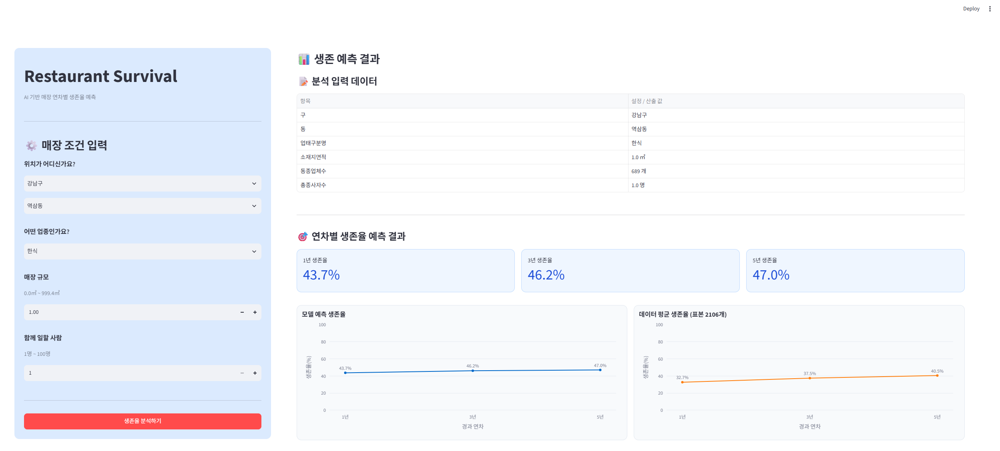
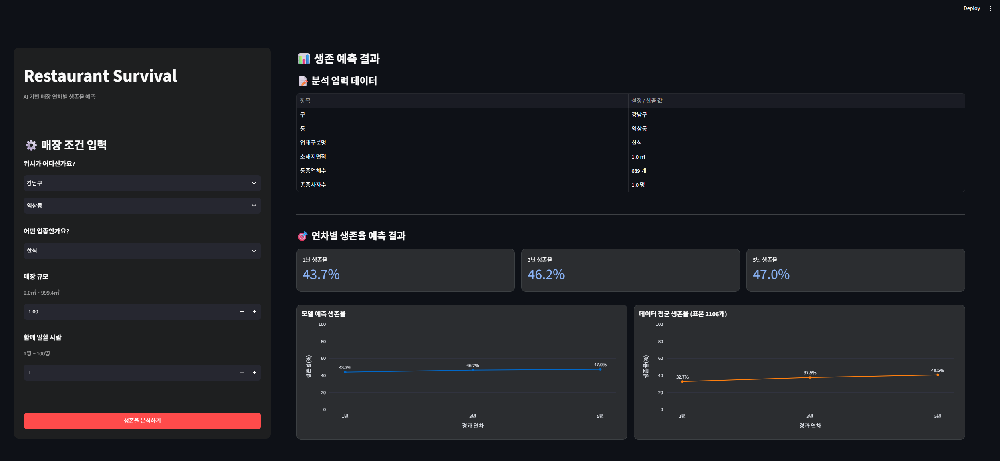

# 외식업 데이터 분석 및 음식점 생존율 예측

서울시 일반음식점 데이터를 활용하여 **1년·3년·5년 기준의 음식점 생존 가능성을 예측**하고, 동일 지역·업종의 데이터 기반 통계와 비교해 보여주는 머신러닝 웹 서비스입니다.

사용자는 구, 동, 업종, 매장 면적, 종사자 수를 입력하고, 각 기간별 모델 예측 결과와 데이터 비교 결과를 그래프와 수치로 확인할 수 있습니다.

> 예측값은 데이터와 모델을 바탕으로 산출한 참고 정보입니다. 실제 창업 성과나 영업 지속 여부를 보장하지 않습니다.

## 프로젝트 배경 및 목적

음식점의 영업 지속 가능성은 입지와 업종뿐 아니라 매장 규모, 인력 구성, 주변의 동일 업종 분포 등 여러 조건과 관련될 수 있습니다. 이 프로젝트는 막연한 판단에 의존하기보다 실제 음식점 데이터를 활용해 이러한 조건을 비교하고, 사용자가 결과를 직관적으로 확인할 수 있는 도구를 만드는 데서 출발했습니다.

프로젝트의 주요 목적은 다음과 같습니다.

- 서울시 일반음식점 데이터를 분석 가능한 형태로 정리합니다.
- 지역과 업종, 매장 조건을 반영한 1년·3년·5년 분류 모델을 구성합니다.
- 머신러닝 예측값과 동일 지역·업종 데이터의 평균값을 구분하여 제공합니다.
- 분석 결과를 카드와 그래프로 시각화해 사용자의 해석을 돕습니다.

이 과정에서 실제 외식업 데이터 처리, 지역·업종별 비교, 예측 결과 시각화와 데이터 기반 문제 해결 과정을 경험했습니다.

## 주요 기능과 실행 화면

### 매장 조건 입력

- 구를 선택하면 해당 구의 동 목록을 불러오는 단계별 지역 선택
- DB에 저장된 음식점 업태 선택
- 매장 면적과 총 종사자 수 입력
- 입력 가능한 면적 범위 표시 및 입력값 검증

### 기간별 모델 예측

- 1년·3년·5년 기준으로 구성한 모델이 영업 지속으로 분류할 확률을 각각 계산
- 기간별 결과를 생존율 요약 카드로 표시
- Plotly 선 그래프로 기간에 따른 모델 예측값 시각화

### 데이터 기반 비교

- 동일한 구·동·업태에 속하는 데이터의 연차별 평균 생존 라벨 표시
- 모델 예측과 DB 평균을 별도 그래프로 구분
- 동일 지역·업종 그룹의 1년 라벨 기준 데이터 건수 표시
- 비교 가능한 데이터가 없을 때 별도 안내 제공

### 결과 대시보드

- 사용자가 선택한 조건과 서버가 산출한 값을 표로 요약
- 라이트 모드와 다크 모드를 고려한 화면 구성
- API 연결 실패, 요청 오류, 데이터 부재 상황에 대한 안내
- 지역·업종 조회 결과를 5분간 캐싱하여 반복 요청 감소

### 서비스 실행 화면

#### 라이트 모드



#### 다크 모드



사용자가 입력한 음식점 조건에 따른 1년·3년·5년 모델 예측 결과를 카드와 그래프로 시각화하고, 동일 지역·업종의 데이터 기반 비교 결과를 함께 제공합니다.

## 활용 데이터 및 분석 과정

### 데이터 개요

| 항목 | 내용 |
|---|---|
| 데이터 | 식품 일반음식점 서울특별시 데이터 |
| 코드 및 발표자료에 기록된 출처 | 공공데이터포털 |
| 원본 크기 | 537,186행 × 39열 |
| 분석 대상 | 2000년 1월 1일 이후 인허가된 음식점 중 필수값을 확인할 수 있는 데이터 |
| 주요 정보 | 인허가일자, 폐업일자, 영업상태, 업태, 소재지면적, 종사자 수, 지번주소 |

원본 데이터의 정확한 공개 페이지 URL과 이용 조건은 저장소에 기록되어 있지 않습니다. 데이터를 재사용할 때는 공공데이터포털에서 원본 페이지와 라이선스를 별도로 확인해야 합니다.

### 데이터 전처리

1. 분석에 사용하지 않는 우편번호, 연락처, 좌표 등 29개 컬럼을 제거했습니다.
2. 인허가일자, 폐업일자와 최종수정시점을 날짜 형식으로 변환했습니다.
3. 2000년 1월 1일 이후 인허가된 음식점만 남겼습니다.
4. 소재지면적과 지번주소가 없는 행을 제거했습니다.
5. 남성·여성 종사자 수의 결측값을 0으로 처리하고 두 값을 합해 총종사자수를 만들었습니다.
6. 지번주소를 공백 기준으로 분리하여 구와 동 정보를 생성했습니다.
7. 숫자형 변수의 결측값은 중앙값, 범주형 변수의 결측값은 최빈값으로 처리했습니다.
8. 구, 동과 업태구분명은 원-핫 인코딩하여 모델에 입력했습니다.

### 모델 입력 변수

현재 서비스에 저장된 모델은 다음 6개 변수를 사용합니다.

| 변수 | 활용 내용 |
|---|---|
| `구` | 음식점이 위치한 구 |
| `동` | 음식점이 위치한 동 |
| `업태구분명` | 한식, 일식, 분식 등 음식점 업태 |
| `소재지면적` | 영업장 면적 |
| `총종사자수` | 남성·여성 종사자 수의 합 |
| `동종업체수` | 같은 구·동·업태 그룹에서 기간별 생존 라벨을 이용해 산출한 업체 수 |

### 생존 라벨 구성

1년·3년·5년 모델은 각 기간을 관측할 수 있는 데이터를 따로 구성합니다. 예를 들어 3년 데이터에는 `인허가일자 + 3년`이 `최종수정시점`보다 빠르거나 같은 사업장만 포함합니다.

그다음 최종 기록의 `영업상태명`이 `폐업`이면 0, 그 외 상태이면 1을 부여합니다. 라벨 해석 시 유의사항은 [분석의 한계](#분석의-한계)에 정리했습니다.

### 모델 학습과 서비스 연결

1. 1년·3년·5년 기준의 데이터셋을 각각 구성합니다.
2. 데이터를 학습용과 평가용으로 80:20 분리하고 클래스 비율을 유지합니다.
3. Random Forest, Gradient Boosting, Logistic Regression을 비교하는 코드를 구성했습니다.
4. 최종 서비스에는 Random Forest 분류 모델을 사용했습니다.
5. 각 기간의 모델을 별도 파일로 저장하고 FastAPI가 시작될 때 불러옵니다.
6. Streamlit이 REST API로 예측을 요청하고 결과를 표와 그래프로 표시합니다.

저장된 Random Forest의 주요 설정은 다음과 같습니다.

```text
n_estimators=300
max_depth=10
min_samples_leaf=3
class_weight="balanced"
random_state=42
```

## 구현 결과 및 데이터 활용

### 데이터와 코드에서 확인된 사실

- 지역과 업종, 매장 면적, 종사자 수, 동종업체 관련 변수를 사용해 기간별 분류 모델을 구성했습니다.
- 1년·3년·5년 모델을 별도로 저장하여 각 기간의 영업 지속으로 분류할 확률을 제공합니다.
- 동일한 구·동·업태 데이터의 평균 생존 라벨과 1년 라벨 기준 데이터 건수를 함께 제공하여 모델 예측과 비교할 수 있도록 했습니다.
- 사용자는 기간별 결과를 수치 카드와 선 그래프로 확인할 수 있습니다.

### 결과에 대한 해석 범위

이 서비스의 출력값은 입력 조건과 학습 데이터의 패턴을 바탕으로 계산한 모델 확률입니다. DB 비교값은 동일 지역·업종 그룹에 속한 기록의 연차별 라벨 평균입니다. 두 결과는 음식점 입지와 운영 조건을 비교하기 위한 참고 자료이며 외식시장 전체를 대표하는 통계로 해석할 수 없습니다.

기간별 최종 모델의 검증 성능은 저장소에 결과 파일로 남아 있지 않으므로 README에 Accuracy, F1-score 또는 ROC-AUC 수치를 제시하지 않았습니다. 지역·업종별 차이에 관한 구체적인 시장 인사이트 역시 별도의 검증 없이 단정하지 않았습니다.

## 담당 역할 및 기여 내용

이 프로젝트는 데이터 전처리, 머신러닝 모델링, 백엔드 및 프런트엔드 개발을 함께 진행한 팀 프로젝트입니다. 아래는 제가 직접 담당한 구현 영역입니다.

### Streamlit 결과 화면 구현

- 모델 예측 결과와 데이터 기반 비교 결과를 한 화면에서 확인할 수 있도록 구성
- 사용자 입력 조건과 서버에서 산출한 정보를 결과 화면에 정리

### Plotly 데이터 시각화

- 1년·3년·5년 모델 예측 결과를 선 그래프로 시각화
- 동일 지역·업종의 DB 평균값을 별도 그래프로 구현하여 비교 가능하도록 구성

### 결과 요약 및 UI 개선

- 1년·3년·5년 모델 예측값을 세 개의 요약 카드로 구현
- CSS를 활용해 결과 카드, 차트 영역 등 화면 디자인 개선
- 라이트·다크 모드에 맞춰 배경색과 강조색을 조정하여 가독성 개선

데이터 전처리, 모델 학습 및 백엔드 개발은 팀 전체의 결과물이며, 개인 단독 수행 업무와 구분했습니다.

## 기술 스택

| 구분 | 활용 기술 |
|---|---|
| 프런트엔드 | Streamlit, Plotly, Pandas, Requests, HTML/CSS |
| 백엔드 | FastAPI, Uvicorn, Pydantic |
| 데이터 처리 | Pandas, NumPy |
| 머신러닝 | scikit-learn, Random Forest, Gradient Boosting, Logistic Regression, LightGBM, SHAP, Joblib |
| 데이터베이스 | SQLite, SQLAlchemy ORM |
| 환경 설정 | python-dotenv |

LightGBM과 SHAP은 특성 중요도를 확인하기 위한 분석 코드에 사용되며, 현재 서비스에 저장된 최종 예측 모델은 Random Forest입니다.

## 실행 방법

### 프로젝트 구조

```text
restaurant_survival/
├── backend/
│   ├── data/
│   │   └── restaurants.db
│   ├── models/
│   │   ├── model_1y.pkl
│   │   ├── model_3y.pkl
│   │   └── model_5y.pkl
│   ├── .env
│   ├── config.py
│   ├── database.py
│   ├── main.py
│   ├── models.py
│   ├── predict_service.py
│   └── schemas.py
├── frontend/
│   └── app.py
├── modeling/
│   ├── dbutil.py
│   ├── main.py
│   └── 식품_일반음식점_서울특별시.zip
├── README.md
└── 음식점_생존예측_팀발표자료.pptx
```

### 1. 실행 환경

- Python 3.10 이상 권장
- 백엔드와 프런트엔드를 서로 다른 터미널에서 실행

현재 저장소에는 `requirements.txt`가 없습니다. 실행 환경에는 코드에서 사용하는 FastAPI, Uvicorn, Streamlit, Plotly, Pandas, Requests, SQLAlchemy, scikit-learn, Joblib, python-dotenv 등의 패키지가 설치되어 있어야 합니다.

### 2. 가상환경 생성 및 활성화

```bash
python -m venv .venv
```

macOS / Linux:

```bash
source .venv/bin/activate
```

Windows PowerShell:

```powershell
.venv\Scripts\Activate.ps1
```

### 3. 모델 및 DB 확인

서비스 실행에는 다음 파일이 필요합니다.

```text
backend/models/model_1y.pkl
backend/models/model_3y.pkl
backend/models/model_5y.pkl
backend/data/restaurants.db
```

모델을 다시 학습하려면 `modeling/식품_일반음식점_서울특별시.zip`을 먼저 압축 해제하여 CSV 파일을 `modeling/` 폴더에 배치해야 합니다. `modeling/main.py`는 ZIP을 자동으로 해제하지 않습니다.

### 4. 환경변수 설정

백엔드는 `backend/.env`를 읽습니다. 기본 구성은 다음 항목을 사용합니다.

```env
DB_PATH=data/restaurants.db
MODEL_DIR=models
MODEL_FILE_1Y=model_1y.pkl
MODEL_FILE_3Y=model_3y.pkl
MODEL_FILE_5Y=model_5y.pkl
ALLOWED_ORIGINS=http://localhost:8501
```

`ALLOWED_ORIGINS`는 `backend/config.py`에서 쉼표를 기준으로 분리합니다. 여러 주소를 허용할 때는 JSON 배열이 아니라 아래처럼 공백 없이 쉼표로 구분합니다.

```env
ALLOWED_ORIGINS=http://localhost:8501,http://127.0.0.1:8501
```

환경변수 파일에는 배포 환경의 경로나 주소가 포함될 수 있으므로 공개 저장소에 올리기 전에 내용을 확인해야 합니다.

### 5. 백엔드 실행

```bash
cd backend
uvicorn main:app --reload --host 0.0.0.0 --port 8000
```

정상 실행 여부는 [상태 확인 페이지](http://localhost:8000/health), API 문서는 [FastAPI 문서](http://localhost:8000/docs)에서 확인할 수 있습니다.

### 6. 프런트엔드 실행

새 터미널에서 실행합니다.

```bash
cd frontend
streamlit run app.py
```

기본 화면 주소는 [http://localhost:8501](http://localhost:8501)입니다.

프런트엔드는 기본적으로 `http://localhost:8000`의 백엔드에 연결합니다. 다른 주소를 사용할 때는 프런트엔드 실행 전에 `API_BASE_URL`을 설정합니다.

Windows PowerShell 예시:

```powershell
$env:API_BASE_URL="http://localhost:8000"
```

### 주요 API

| Method | Endpoint | 설명 |
|---|---|---|
| `GET` | `/health` | 서버 상태 확인 |
| `GET` | `/api/gu` | 구 목록 조회 |
| `GET` | `/api/dong?gu={구}` | 선택한 구의 동 목록 조회 |
| `GET` | `/api/business-types` | 업태 목록 조회 |
| `GET` | `/api/area-range` | 입력 가능한 면적 범위 조회 |
| `POST` | `/api/predict` | 기간별 모델 예측값과 DB 비교값 반환 |

## 분석의 한계

현재 생존 라벨은 각 기간 이상 관측 가능한 사업장을 선별한 뒤 최종 영업상태를 기준으로 생성했습니다. 따라서 정확히 개업 후 1년·3년·5년 시점의 영업 여부를 추적한 일반적인 생존율과는 차이가 있습니다.

또한 `동종업체수`는 지역·업종별 생존 라벨 합계로 계산한 뒤 학습용과 평가용 데이터를 분리했습니다. 이 과정에서 정답 정보가 입력 변수에 포함되는 데이터 누수 가능성이 있으므로 모델 예측값과 성능은 참고 수준으로 해석해야 합니다.

구와 동을 지번주소에서 분리하는 과정에서 주소 형식에 따른 오분류 가능성이 있으며, 매출, 임대료, 유동인구와 같은 외식업 운영 변수는 모델에 포함되지 않았습니다. 저장소에서 검증할 수 없는 성능 수치나 시장 인사이트는 제시하지 않았습니다.

이 프로젝트의 모델 결과와 DB 통계는 위 한계를 고려해 참고 자료로 활용해야 합니다.
